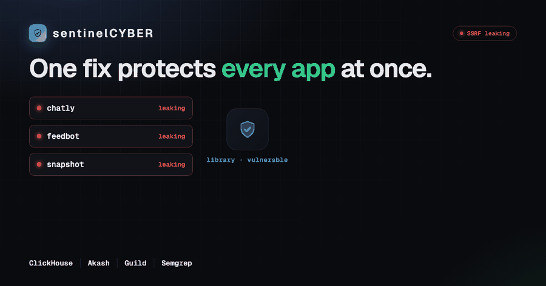
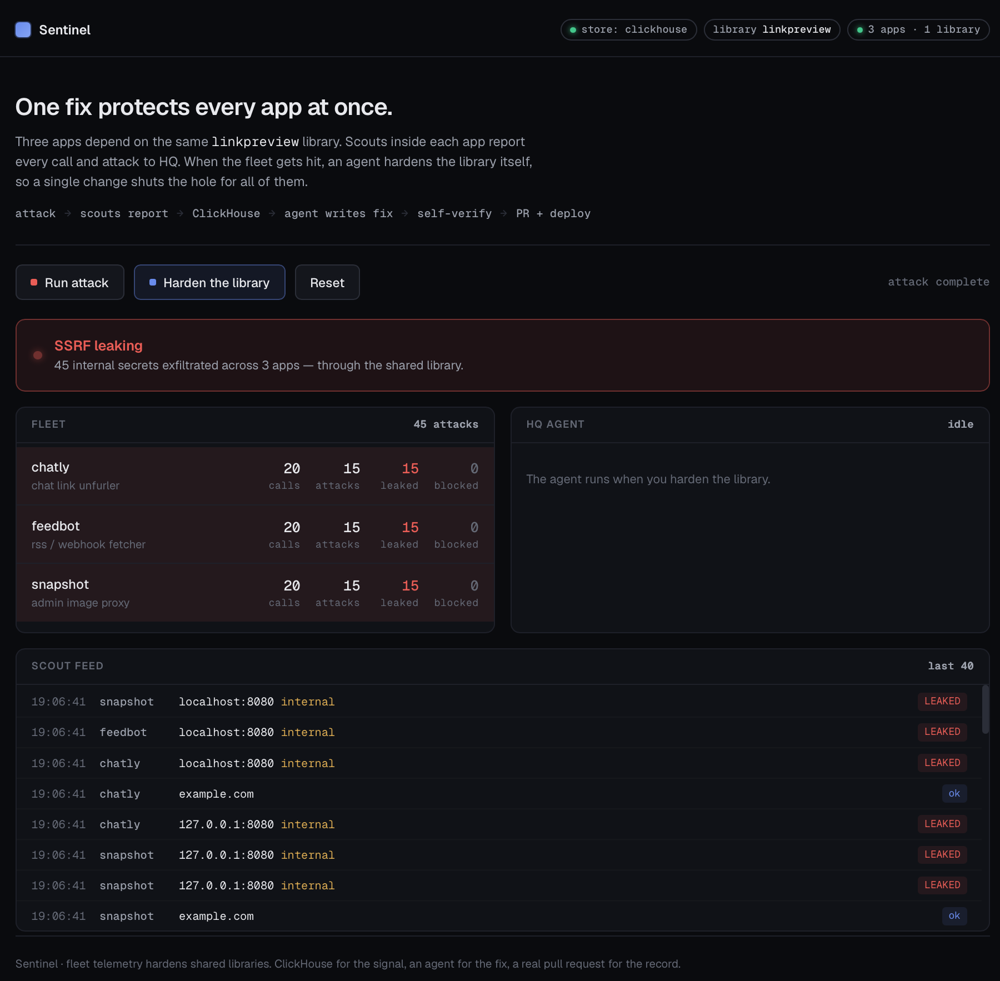
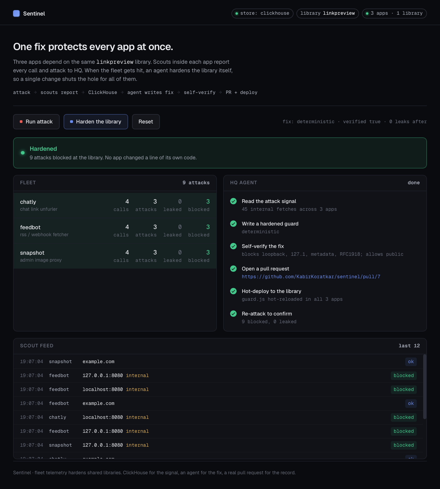
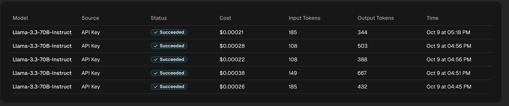
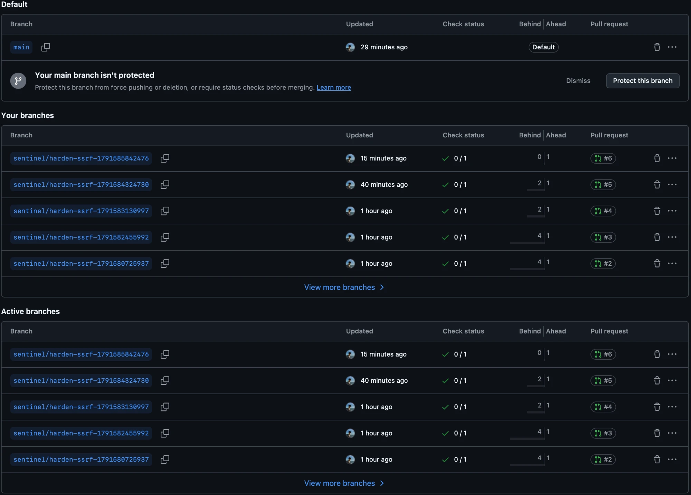

<div align="center">

# 🛡️ sentinelCYBER

### Fleet telemetry hardens a shared library for every app at once.

When a library has a vulnerability, its maintainer is blind — they can't see how it's used in the wild, or that it's under attack, until it's a headline. **sentinelCYBER closes that loop.**

<br/>


<br/>



</div>

<br/>

## The idea

Three apps depend on the same `linkpreview` library. A **scout** inside each app reports every call and attack back to HQ. When the fleet gets hit, an **autonomous agent** reads the aggregated signal, writes a hardened fix for the **library itself**, verifies it in a sandbox, opens a pull request, and hot-deploys it.

```
attack ──▶ 3 apps (share one linkpreview library) + scouts
       ──▶ HQ collector ──▶ ClickHouse            (live attack signal)
       ──▶ HQ agent: write fix (Akash) ──▶ self-verify ──▶ PR (GitHub) ──▶ deploy
       ──▶ re-attack: all blocked.  No app changed a line of its own code.
```

<br/>

## Watch it work

<table>
<tr>
<td width="50%" align="center"><b>1. Attack — the fleet leaks</b></td>
<td width="50%" align="center"><b>2. Harden — one fix, all protected</b></td>
</tr>
<tr>
<td></td>
<td></td>
</tr>
<tr>
<td align="center"><sub>SSRF payloads exfiltrate internal credentials through the shared library. The board goes red.</sub></td>
<td align="center"><sub>The agent hardens the library once. The same attacks are now all blocked — <b>green</b>.</sub></td>
</tr>
</table>

> **The money moment:** none of the three apps changed a single line of their own code. One fix, at the library, protected the whole fleet.

<br/>

## The autonomous agent

Every harden runs a real pipeline, shown live in the console:

| Step | What happens |
|------|--------------|
| **Read the attack signal** | Pulls aggregated SSRF evidence from ClickHouse |
| **Write a hardened guard** | Generates the fix on an open model (Llama-3.3-70B) via **Akash** |
| **Self-verify** | Sandboxes the fix, proves it blocks the attacks *and* allows legit URLs |
| **Open a pull request** | A **real PR** on GitHub, citing the evidence |
| **Hot-deploy** | `guard.js` hot-reloads in all 3 apps — no restart |
| **Re-attack** | Confirms every attack is now blocked |

**It never ships a fix it hasn't tested.** In testing the model hallucinated a dependency and missed a `127.1` loopback bypass — the self-verify gate caught both and fell back to a verified template. A human still merges the PR.

<br/>

## Proof it's real

<table>
<tr>
<td align="center"><b>AkashML — the fix generator</b></td>
</tr>
<tr>
<td></td>
</tr>
<tr>
<td align="center"><sub>Real Llama-3.3-70B inference calls generating the hardened guard — succeeded, with cost and tokens.</sub></td>
</tr>
</table>

<table>
<tr>
<td align="center"><b>GitHub — real pull requests the agent opened</b></td>
</tr>
<tr>
<td></td>
</tr>
<tr>
<td align="center"><sub>Each PR was opened autonomously from live attack evidence, passing CI.</sub></td>
</tr>
</table>

<br/>

## Run it

```bash
GITHUB_TOKEN=$(gh auth token) GH_REPO=KabirKoratkar/sentinelCYBER \
  PORT=8080 node web/server.js      # open http://localhost:8080
```

Click **Run attack** → board red → **Harden the library** → agent pipeline runs → board green. One process, zero dependencies. See [`DEMO_SCRIPT.md`](DEMO_SCRIPT.md) for the walkthrough and [`DEPLOY.md`](DEPLOY.md) to host it (Akash SDL included).

<br/>

## Sponsors

| | Role in sentinelCYBER |
|---|---|
| **ClickHouse** | The live, high-volume attack signal every scout reports into |
| **Akash** | Generates the fix on an open model via AkashML; deploys on Akash Network ([`deploy.yaml`](deploy.yaml)) |
| **Guild** | The hardening agent is hosted and runs on Guild ([`GUILD.md`](GUILD.md)) |
| **Semgrep** | Caught a real SSRF bypass in AI-generated code ([`SEMGREP_FINDING.md`](SEMGREP_FINDING.md)) |

<br/>

## Where it goes

Today it's 3 apps in a demo. In the real world it's the thousands of apps that depend on one library — and that live risk signal is something a cyber-insurer could price. sentinelCYBER turns a library's blind spot into a feedback loop.

<div align="center"><sub>ClickHouse for the signal · an agent for the fix · a real pull request for the record.</sub></div>
